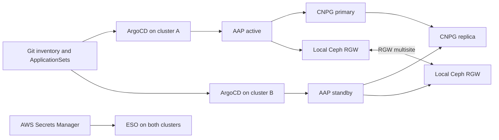

# AAP HA/DR example

This repository is a GitOps reference for Ansible Automation Platform on two
OpenShift clusters.

The example uses AWS/ROSA, AAP 2.7, CloudNativePG, External Secrets Operator with
AWS Secrets Manager, and ODF Ceph RGW. It contains reusable manifests, ApplicationSets,
a synthetic two-cluster inventory, bootstrap helpers, and an Ansible operations
collection.

**Live deployment qualification is pending.** Local rendering is not proof of HA/DR
behavior.

## Topology



The desired primary is stored in the pair inventory. RGW roles are fixed and do
not change with CNPG/AAP promotion. A switchover requires the operations workflow;
changing the desired-primary field alone is not sufficient.

## Quick start

```sh
python3 -m venv .venv
. .venv/bin/activate
python3 -m pip install -r requirements.txt
cp -R examples/aws-rosa-pair my-deployment
# edit my-deployment/settings.yaml,
# my-deployment/deployment/argocd/environments/*.yaml, and
# my-deployment/deployment/argocd/pairs/*.yaml
make validate configure render ops-inventory DEPLOYMENT=my-deployment
```

Publish the configured Git revision before asking ArgoCD to sync it. See
[getting started](docs/getting-started.md) for the deployment order.

## Documentation

- [Getting started](docs/getting-started.md): prerequisites, local commands, and bootstrap order.
- [Configuration](docs/configuration.md): inventory fields and fixed names.
- [Secrets](docs/secrets.md): secret backend objects and required keys.
- [Operations](docs/operations.md): preflight, switchover, and recovery guidance.
- [Validation](docs/validation.md): local checks and known limits.

The example keeps the namespace and resource names `aap` and `aap-postgres`. Other
names, storage backends, secret backends, providers, and additional workloads are
not covered by the current validation.
